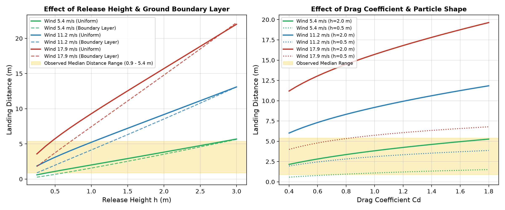

# Save the Earth — Wildfire Firebrand Transport Research

**Status: reproducible computational research prototype, not a validated operational wildfire forecast.**

This KAIST student research project studies how windborne burning particles (firebrands) are transported and deposited. It combines a numerical 3D aerodynamic model, literature-informed simplified combustion physics, neural surrogates, and evaluation against published experimental *run-level* landing summaries. The project's key unresolved challenge is independent validation with matched, time-resolved physical trajectory measurements.

> **KAIST Save the Earth Global Challenge — start here:** [AI research handoff](grant/AI_CONTEXT.md) · [Claim and evidence register](grant/CLAIM_REGISTER.md) · [Scientific evidence](grant/scientific_evidence.md) · [Model limitations](grant/model_limitations.md). These files provide context for the four-person team's **separately written official application**. The repo contains no approved itinerary, host invitation, final application or confirmed experimental access.

## Research question and scope

Can computational models estimate the transport and landing of windborne embers under stated aerodynamic assumptions, and which additional physical measurements are necessary to validate these predictions?

**Three different outcomes must not be conflated:**

1. **Particle transport/deposition** — airborne path, flight time, landing position or run-median landing distance. This is the primary implemented task.
2. **Thermal survival** — whether an ember remains hot or burning when it lands. Not validated.
3. **Spot-fire ignition and growth** — whether receptive fuel ignites and the new fire spreads. Not validated or forecast by this project.

## What is implemented

| Component | Implemented work | Source |
| --- | --- | --- |
| Numerical transport | RK4 particle integration with drag, gravity, idealized wind shear and updraft; optional simplified lift, effective combustion buoyancy and mass/area shrinkage | [3D physics engine](src/save_the_earth/physics/aerodynamics.py) |
| Fast trajectory approximators | Models B (neural) and C (physics-hybrid) trained on simulated RK4 trajectories | [trajectory models](src/save_the_earth/models/trajectory_models.py) · [training report](reports/TRAJECTORY_TRAINING_10K.md) |
| Experimental-run landing predictors | Ridge, Huber, random-forest and other baselines for **aggregate run-median** deposition distance | [benchmark implementation](train_distance_benchmarks.py) · [evidence](grant/scientific_evidence.md) |
| Reconstructed particle distribution | Generated, moment-matched synthetic particle records derived from published USDA statistics; **not original measured particle rows** | [dataset manifest](data/manifests/usda_particles_manifest.json) |
| Model E | Deep quantile/distance estimator trained on reconstructed synthetic rows | [model](src/save_the_earth/models/experimental_surrogate.py) · [recorded metrics](reports/experimental_training_metrics.json) |
| OpenPTV geometry | Ingestion/reconstruction of limited real optical 3D tracks; verified timebase and release conditions are missing | [OpenPTV analysis](reports/OPENPTV_EXPERIMENTAL_VALIDATION.md) |
| Numerical sensitivity and ablation | Impact of model assumptions on simulated landing and flight time | [ablation results](reports/physics_ablation_results.json) · [sensitivity script](physics_sensitivity.py) |

The drag/lift, combustion-buoyancy and shrinkage terms are **literature-informed phenomenological approximations**, not a verified six-degree-of-freedom orientation/combustion solver. See [scientific limitations](grant/model_limitations.md) and verify specific citations against primary papers before external publication.

## Results — each metric has a distinct target

| Dataset / evidence | Recorded result | What it does **not** establish |
| --- | --- | --- |
| **10,000 simulated trajectories** (1,500 simulated held-out test paths; 500 additional OOD scenarios) | Model C **1.750 m 3D position MAE**, Model B **4.736 m** against RK4-generated paths | Real-world firebrand trajectory accuracy. Model B's recorded OOD 3D MAE is ~**113.1 m** |
| **69 published USDA/IBHS experimental-run summaries** | Huber **0.995 m** five-fold group-CV MAE and **1.763 m** held-out test MAE; Ridge held-out test MAE **1.721 m** | 3D motion, individual-particle landing error, thermal survival or actual ignition |
| **60,370 synthetic reconstructions from USDA moments** (8,841 synthetic held-out test rows) | Prospective Ridge **4.689 m** MAE on reconstructed particles | Direct measurement or independent individual-particle experimental validation |
| **Model E on reconstructed synthetic particles** | Latest recorded test MAE **5.248 m**; nominal 80% intervals cover only **60.1%** of test rows, or **63.4%** after CQR | Reliable, well-calibrated 80% uncertainty on new real fuels |
| **OpenPTV optical reconstruction** | Recorded **68 multi-frame tracks** from a short image sequence | Quantitative velocity or full 3D prediction MAE without verified FPS, wind, particle properties and release conditions |

Evidence and versions: [synthetic trajectory metrics](reports/trajectory_evaluation_metrics.json), [reconstructed particle metrics](reports/usda_particle_evaluation_metrics.json), [latest Model E training metrics](reports/experimental_training_metrics.json), [USDA experiment provenance](reports/REAL_DATA_ACQUISITION.md), [claim register](grant/CLAIM_REGISTER.md). Some older outputs are from different model checkpoints/evaluation stages: **do not combine numbers from different runs without checking their version and task**.

### Why experiment matters

In the numerical sensitivity study, changing unmeasured release height can substantially change predicted landing distance. The added aerodynamic/combustion mechanisms also change modeled trajectories in an ablation study. These are **computed sensitivities under assumptions**, not experimental measurements or evidence of improved real-world accuracy. Controlled observations with verified timestamps, wind conditions, geometry, orientation and release kinematics are needed to test whether the approximations hold.

Australian research groups including CSIRO and UNSW Canberra offer relevant expertise in bushfire physics and measurement methods. They are **potential research contacts only**; no laboratory visit, supervision, data sharing, or new experiment is confirmed. See [Australia research prospecting](docs/AUSTRALIA_RESEARCH_PLAN.md).



*Figure: numerical model sensitivity, not external validation.*

## Getting started

Install dependencies and run the checked-in tests:

```bash
python3 -m pip install -r requirements.txt
python3 -m unittest discover -s tests -v
```

Run the main research pipeline (requires the dependencies and source artifacts expected by the scripts):

```bash
python3 run_pipeline.py
```

Query a **research-only** run-median deposition-distance estimator within its modeled wind-tunnel context:

```bash
python3 run_pipeline.py --predict --wind 15.0 --category vegetative
```

The command above is **not** a wildfire warning, risk map, ignition forecast or field-ready estimate.

## Where to look

- **Scientific handoff to another AI:** [grant/AI_CONTEXT.md](grant/AI_CONTEXT.md)
- **Claim-by-claim source map:** [grant/CLAIM_REGISTER.md](grant/CLAIM_REGISTER.md)
- **Evidence summary:** [grant/scientific_evidence.md](grant/scientific_evidence.md)
- **Known model limitations:** [grant/model_limitations.md](grant/model_limitations.md)
- **Experimental-data acquisition and availability:** [reports/REAL_DATA_ACQUISITION.md](reports/REAL_DATA_ACQUISITION.md)
- **Source metadata and synthetic data labeling:** [data/README.md](data/README.md) · [USDA manifest](data/manifests/usda_particles_manifest.json)
- **Experimental and numerical reports:** [reports/](reports/) and [source code](src/save_the_earth/)
- **Bibliography for verification:** [grant/references.bib](grant/references.bib)

**This GitHub repository supplies technical context and preliminary evidence.** The official KAIST application, team identities, approvals, verified travel budget and external appointments will be handled by the team separately.
